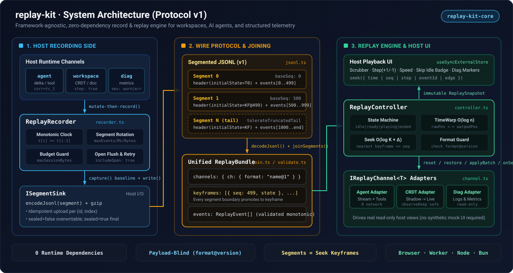
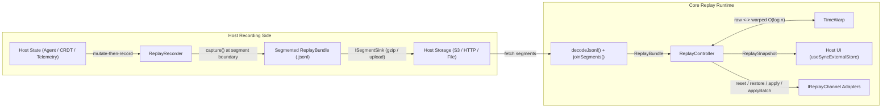
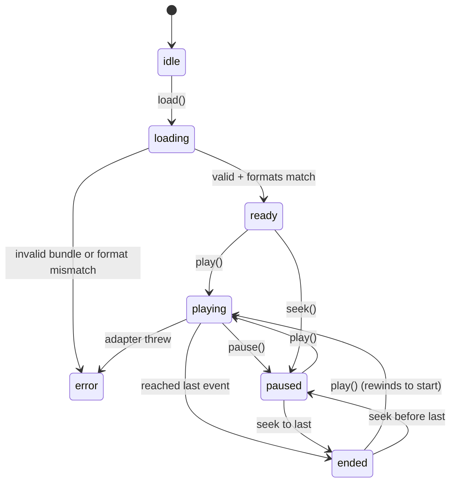
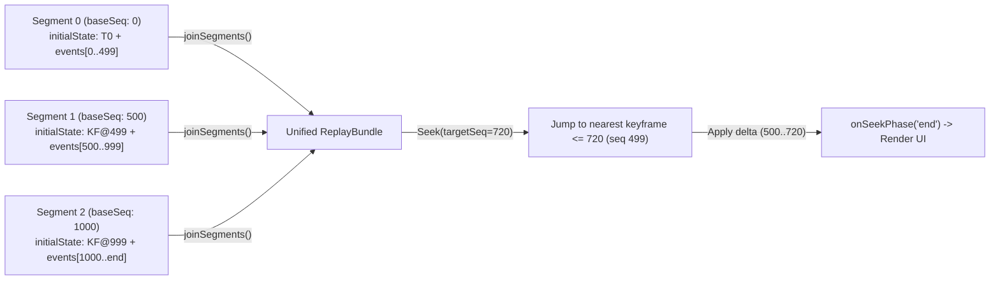
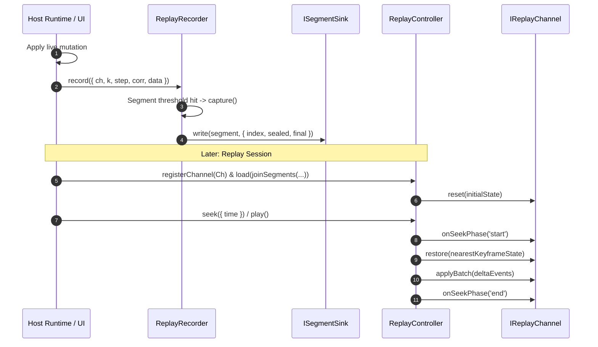

# replay-kit


Framework-agnostic, zero-dependency record & replay engine for collaborative workspaces, AI agents, and structured telemetry streams.

See [PROTOCOL.md](./PROTOCOL.md) for the v1 bundle, JSONL wire format, segmentation, adapter, and recorder specification.

---

## Design Philosophy & Core Invariants

1. **Payload-blind core**: `@replay-kit/core` never interprets channel payloads. Events carry opaque JSON-serializable `data` routed by `ch` to host-implemented channel adapters, checked only against a declared versioned format (`format@version`).
2. **Zero runtime dependencies & zero environment assumptions**: Written in pure TypeScript with no DOM, Node, or bundler-specific runtime imports. It runs identically in browsers, workers, SSR, Node, and Bun.
3. **Segments = keyframes**: Rather than maintaining a separate checkpoint policy, every rotated segment captures a full `initialState` baseline via host `captures[ch]()`. Joining segments turns each boundary into an O(log K) seek keyframe with no bespoke snapshot format.
4. **Mutate-then-record contract**: Hosts apply mutations to their own state first, then call `recorder.record(...)`. Whenever a segment boundary rotates immediately afterward, `capture()` reflects the post-event state deterministically.
5. **Single unified timeline**: Agent streams, user prompts, workspace/CRDT updates, and diagnostic telemetry share one monotonic `t` clock (`ms`), correlated via optional `corr`, severity-tagged with `sev`, and step-indexed via `step: true`.

---

## Architecture Overview





### Module Layout (`packages/core/src/`)

| Module | Responsibility |
| --- | --- |
| `protocol.ts` | Wire types (`ReplayBundle`, `ReplayEvent`, `ReplayKeyframe`, `ReplayChannelDecl`, `ReplayPlaybackPolicy`) and default constants (`DEFAULT_MAX_IDLE_GAP_MS = 1800`, `DEFAULT_COMPRESSED_GAP_MS = 900`, `DEFAULT_SPEED = 1`). |
| `validate.ts` | Structural and semantic validation (`validateBundle`, `parseBundle`, `ReplayValidationError`): monotonic `t`, declared channels, valid keyframe indices, and channel-key integrity. |
| `jsonl.ts` | Streaming-friendly JSONL encoder & decoder (`encodeJsonl`, `decodeJsonl`) with `tolerateTruncatedTail` support for reading interrupted open segments. |
| `join.ts` | Multi-segment validator & merger (`joinSegments`): checks contiguous `segment.index` and `baseSeq`, elevates segment `initialState` into keyframes, and produces one self-contained `ReplayBundle`. |
| `time-warp.ts` | Piecewise-linear idle-gap compressor (`TimeWarp.build`, `rawToWarped`, `warpedToRaw`, `idleGapAt`). |
| `index-utils.ts` | Pure binary search helpers (`lastSeqAtOrBefore`, `findKeyframeIndex`, `buildStepIndex`, `stepIndexAtOrBefore`). |
| `channel.ts` | Host adapter contract (`IReplayChannel<TSnapshot>`) and `ReplayAdapterContext`. |
| `controller.ts` | Stateful playback state machine (`ReplayController`), frame loop, seek/step logic, and immutable `ReplaySnapshot` store. |
| `recorder.ts` | Monotonic timestamping, automatic rotation (`maxEvents`, `maxMs`, `maxBytes`), byte budget guard (`maxSessionBytes`), retryable `ISegmentSink` drain queue, and `flush({ includeOpen: true })`. |

---

## Key Mechanisms

### 1. `ReplayController` State Machine & UI Binding



`controller.snapshot` returns an immutable reference replaced on every state change, designed directly for React's `useSyncExternalStore`:

```ts
const snapshot = useSyncExternalStore(
  (cb) => controller.subscribe(cb),
  () => controller.snapshot,
);
```

### 2. Idle Time Compression (`TimeWarp`)

Long sessions often include multi-second waits (model warmups, cloud generation jobs, user pauses).
- Gaps strictly greater than `maxIdleGapMs` (default `1800ms`) compress linearly down to `compressedGapMs` (default `900ms`).
- Both `rawToWarped` and `warpedToRaw` run in **O(log n)** via binary search.
- Playback's true cursor is always `rawPos`: toggling `setSkipIdle()` or `setSpeed()` rebuilds the mapping without losing position.
- During a compressed interval, `snapshot.activeIdleGap` exposes `{ rawGapMs }` so the UI can show badges like `Skipping 35.0s idle`.

### 3. Fast Seeking (`O(log K + Δ)`) & Adapter Batching





- Supports 5 seek targets: `{ time }`, `{ seq }`, `{ step }`, `{ eventId }`, and `{ edge: 'start' | 'end' }`.
- Forward seeks within the same segment apply `(currentSeq + 1 .. targetSeq)` incrementally with zero reset overhead.
- Backward seeks or jumps across keyframes bracket with `onSeekPhase('start')` → restore/reset channels to the nearest keyframe `<= targetSeq` → replay remaining delta `Δ` (`applyBatch` for consecutive same-channel events) → `onSeekPhase('end')`.
- Recommended CRDT / Yjs pattern: apply recorded snapshots & binary updates inside a private **shadow document**, and project diffed keys into the live **UI document** using a dedicated origin so local observers, undo managers, and live object references stay intact.

### 4. Segmented Recording & `diag` Convention

- Rotate segments automatically by `maxEvents` (500), `maxMs` (60,000), or `maxBytes` (262,144).
- Periodically call `recorder.flush({ includeOpen: true })` (e.g. every 10s + on `pagehide`) to upload unsealed tail segments before crashes or tab closes; `decodeJsonl(..., { tolerateTruncatedTail: true })` recovers incomplete uploads safely.
- When `maxSessionBytes` is exceeded, `ReplayRecorder` emits one `record.limit` (`sev: 'warn'`) event on the `diag` channel (if declared) and cleanly halts further recording without throwing.
- Use `corr` to tie cross-channel events together (e.g., an assistant `toolCallId` on `agent.stream`, the workspace CRDT mutations it caused on `workspace`, and execution timing on `diag`).

---

## Installation

Install directly from the published GitHub Release tarball (no private registry required):

```bash
pnpm add https://github.com/ByteFluffy/replay-kit/releases/download/v0.1.0/replay-kit-core-0.1.0.tgz
```

Or with npm / yarn / bun:

```bash
npm install https://github.com/ByteFluffy/replay-kit/releases/download/v0.1.0/replay-kit-core-0.1.0.tgz
```

---

## Quickstart (Minimal Single-Channel Example)

```ts
import {
  ReplayController,
  ReplayRecorder,
  type IReplayChannel,
} from '@replay-kit/core';

let count = 0;

const recorder = new ReplayRecorder({
  id: 'session-1',
  host: 'example',
  channels: { counter: { format: 'counter@1' } },
  captures: { counter: () => count },
});

recorder.start();
count += 1;
recorder.record({ ch: 'counter', k: 'inc', step: true, data: 1 });
await recorder.stop();

const bundle = recorder.compile();

const controller = new ReplayController();
const adapter: IReplayChannel<number> = {
  channel: 'counter',
  formats: ['counter@1'],
  reset(initial) {
    count = initial ?? 0;
  },
  restore(snapshot) {
    count = snapshot;
  },
  apply(event) {
    count += event.data as number;
  },
};

controller.registerChannel(adapter);
controller.load(bundle);
controller.play();
```

---

## Production Usage Guide

### Step 1: Implement Channel Adapters (`IReplayChannel`)

```ts
import type { IReplayChannel, ReplayEvent } from '@replay-kit/core';

export class DiagChannelAdapter implements IReplayChannel<null> {
  readonly channel = 'diag';
  readonly formats = ['diag@1'] as const;
  entries: ReplayEvent[] = [];

  reset(): void {
    this.entries = [];
  }

  restore(): void {
    this.entries = [];
  }

  apply(event: ReplayEvent): void {
    this.entries = [...this.entries, event];
  }

  applyBatch(events: readonly ReplayEvent[]): void {
    this.entries = [...this.entries, ...events];
  }
}
```

### Step 2: Implement an Idempotent `ISegmentSink`

```ts
import { encodeJsonl, type ISegmentSink, type ReplayBundle, type SegmentWriteInfo } from '@replay-kit/core';

export class HttpSegmentSink implements ISegmentSink {
  async write(segment: ReplayBundle, info: SegmentWriteInfo): Promise<void> {
    const jsonl = encodeJsonl(segment);
    const keepalive = !info.sealed && jsonl.length < 60_000;
    const res = await fetch(
      `/api/replay/${encodeURIComponent(segment.id)}/segments/${info.index}?sealed=${info.sealed ? '1' : '0'}`,
      {
        method: 'PUT',
        headers: { 'Content-Type': 'application/x-ndjson' },
        body: jsonl,
        keepalive,
      },
    );
    if (!res.ok) throw new Error(`Upload failed (${res.status})`);
  }
}
```

### Step 3: Record Multi-Channel Sessions

```ts
const recorder = new ReplayRecorder({
  id: sessionId,
  host: 'my-app',
  title: 'Demo Session',
  channels: {
    'agent.stream': { format: 'agent-stream@1' },
    workspace: { format: 'crdt-yjs@1' },
    diag: { format: 'diag@1' },
  },
  captures: {
    'agent.stream': () => getAgentSnapshot(),
    workspace: () => ({ s: encodeWorkspaceSnapshotBase64() }),
    diag: () => null,
  },
  sink: new HttpSegmentSink(),
  maxSessionBytes: 20 * 1024 * 1024,
});

recorder.start();

// Record agent delta correlated to toolCallId
recorder.record({
  ch: 'agent.stream',
  k: 'delta',
  corr: toolCallId,
  data: chunk,
});

// Record semantic workspace update
recorder.record({
  ch: 'workspace',
  k: 'update',
  step: true,
  corr: toolCallId,
  data: { u: deltaBase64 },
});

// Record warning/error diagnostic
recorder.record({
  ch: 'diag',
  k: 'render.stall',
  sev: 'warn',
  corr: toolCallId,
  data: { durationMs: 2400 },
});

// Flush open tail periodically or on pagehide
await recorder.flush({ includeOpen: true });

// Seal final segment when session finishes
await recorder.stop();
```

### Step 4: Load, Join & Playback

```ts
import { ReplayController, decodeJsonl, joinSegments } from '@replay-kit/core';

const segmentTexts: Array<{ text: string; sealed: boolean }> = await fetchSegments();
const segments = segmentTexts.map(({ text, sealed }) =>
  decodeJsonl(text, { tolerateTruncatedTail: !sealed }),
);

const bundle = segments.length === 1 && !segments[0]!.segment
  ? segments[0]!
  : joinSegments(segments);

const controller = new ReplayController();
controller.registerChannel(workspaceAdapter);
controller.registerChannel(agentAdapter);
controller.registerChannel(diagAdapter);

controller.load(bundle);
controller.play();

// Scrub / Step / Speed / Idle compression controls:
controller.seek({ time: 12_500 });
controller.seek({ eventId: 'evt-42' });
controller.step(1);
controller.step(-1);
controller.setSpeed(2);
controller.setSkipIdle(false);
```

---

## Development & Verification

Conformance fixtures live in [`conformance/`](./conformance).

```bash
cd packages/core
npm run typecheck
npm test
npm run build
```
